### Hi, I'm Stephanos 👋

I work at Cosmos. Before that I was at Apple and Squarespace tackling E-commerce.

Outside of work I'm building [shadowgraph](https://shadowgraph.io), a search engine for open-source repos, models and research papers.

I have a soft spot for functional programming languages like Ocaml and Rust, and developer tooling like Git.

Contact me:
[LinkedIn](https://www.linkedin.com/in/stephanos-tsoucas/)

 

#### 👷 What I'm working on

- [nosman/gossamer](https://github.com/nosman/gossamer) - Track your thought process alongside your code (2 months ago)
- [nosman/homebrew-gossamer](https://github.com/nosman/homebrew-gossamer) - To make gossamer installable via homebrew (7 months ago)

#### 🌱 Latest projects

- [nosman/homebrew-gossamer](https://github.com/nosman/homebrew-gossamer) - To make gossamer installable via homebrew
- [nosman/gossamer](https://github.com/nosman/gossamer) - Track your thought process alongside your code
- [nosman/Bson2](https://github.com/nosman/Bson2) - Bson encodings for Ocaml
- [nosman/Ocamlapi](https://github.com/nosman/Ocamlapi) - Path-based http request routing in Ocaml.
- [nosman/DiHMM](https://github.com/nosman/DiHMM)

#### ⭐ Recent stars

- [stablyai/orca](https://github.com/stablyai/orca) - Orca is the place for working with a fleet of agents (e.g. Grok Bot, Claude Code). Run any coding agent with your own subscription. Available on desktop, mobile and remote runtime. (1 month ago)
- [AeneasVerif/aeneas](https://github.com/AeneasVerif/aeneas) - A verification toolchain for Rust programs (1 month ago)
- [ocsigen/wax](https://github.com/ocsigen/wax) - Rust-like syntax for WebAssembly featuring a full toolchain for conversion, type-checking, and auto-formatting. (1 month ago)
- [diku-dk/futhark](https://github.com/diku-dk/futhark) - :boom::computer::boom: A data-parallel functional programming language (1 month ago)
- [Graphify-Labs/graphify](https://github.com/Graphify-Labs/graphify) - Turn any codebase, with its docs, SQL schemas, configs, and PDFs, into a queryable knowledge graph. A /graphify skill for Claude Code, Cursor, Codex, and Gemini CLI: local deterministic AST parsing, every edge explained, no vector store. (2 months ago)
